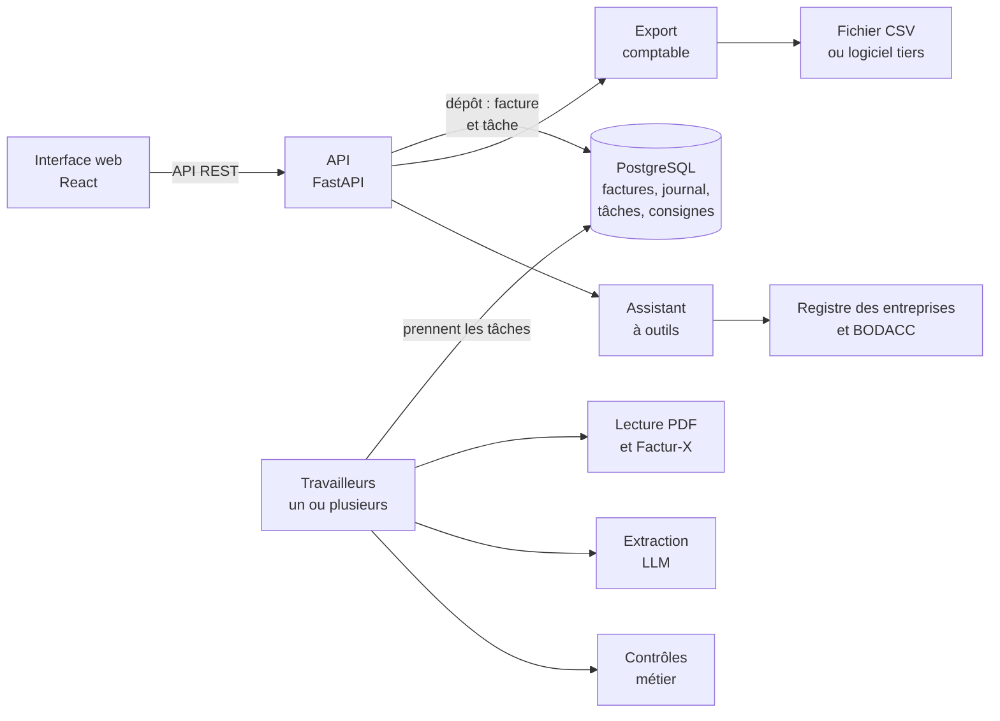
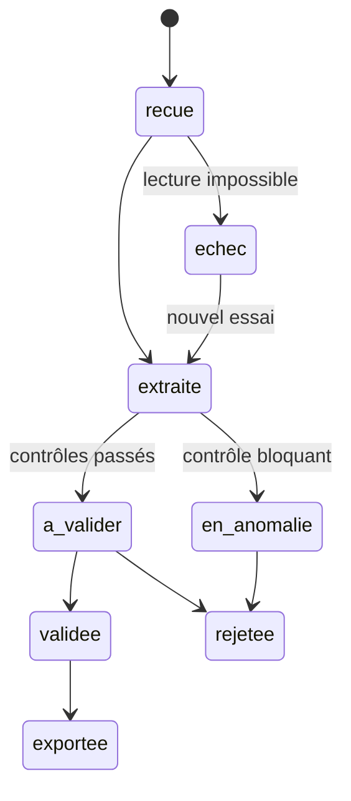

# DocuFlow AI

Traitement automatique des factures fournisseurs : lecture, contrôle, validation et envoi à la comptabilité.

Une entreprise reçoit des factures en PDF. Aujourd'hui, une personne les lit et recopie les montants dans son logiciel de comptabilité. DocuFlow fait la lecture et les vérifications ; la personne ne fait plus que décider.

> Projet de démonstration. Les factures du dossier `factures/` sont fictives. Une seule cite un fournisseur réel, l'entreprise MD Plomberie, avec l'accord de son dirigeant, pour montrer une vérification réussie auprès des registres de l'État : elle porte la mention « Spécimen » et ne correspond à aucune prestation réelle.

## Ce que fait le système

1. **Reçoit** une facture PDF, déposée à l'écran ou envoyée par mail à l'adresse de dépôt, et reconnaît un fichier ou un mail déjà reçu sans le retraiter.
2. **Lit** les données :
   - facture électronique **Factur-X** : lecture directe du XML joint, sans IA ;
   - PDF ordinaire : lecture du texte sur place, puis extraction des champs par un LLM.
3. **Contrôle** les données avec des règles écrites en code, sans IA : totaux, TVA, SIRET, numéro de TVA, dates, doublons.
4. **Fait décider une personne** : rien n'est validé automatiquement.
5. **Envoie** la facture validée à la comptabilité, sous forme d'écriture au journal des achats.
6. **Garde la trace** de chaque étape : qui, quoi, quand, avec quel résultat.

Un **assistant** répond aux questions sur les factures, vérifie un fournisseur auprès des registres de l'État et rédige les courriels aux fournisseurs. Il propose des décisions, il ne les prend jamais.

## Le principe

```text
le LLM lit et propose  ->  les règles vérifient  ->  une personne décide
```

L'IA n'est jamais seule juge. Exemple réel rencontré pendant le développement : un petit modèle a recopié un numéro de TVA en perdant deux chiffres, sans rien signaler. Le contrôle de la clé du numéro de TVA détecte ce genre d'erreur à coup sûr.

## Architecture



Le dépôt d'une facture répond tout de suite : la facture et sa tâche de lecture sont enregistrées ensemble. Un processus séparé, le **travailleur**, prend les tâches une à une et fait la lecture. On peut en lancer plusieurs.

| Dossier | Contenu |
|---|---|
| `moteur/` | Le moteur en Python : lecture, extraction, contrôles, workflow, export, assistant, API, travailleur |
| `migrations/` | Les migrations du schéma de la base (Alembic) |
| `interface/` | L'interface web : React, TypeScript, Vite |
| `tests/` | 199 tests automatisés |
| `factures/` | Factures fictives et réponses attendues |
| `outils/` | Générateur de factures et outils de mesure |

### Les états d'une facture



Toute autre transition est refusée par le code. Une facture en anomalie ne peut pas être validée ; une facture ne peut pas être exportée deux fois.

## Chiffres mesurés

Mesures faites le 14 novembre 2026 sur les factures du dossier `factures/`, avec `uv run python -m outils.mesurer`.

| Étape | Temps |
|---|---|
| Lecture du texte d'un PDF | 8 à 22 ms |
| Lecture d'une facture Factur-X | 2,6 ms |
| Extraction par le LLM (`gpt-5.4-mini`) | 1,1 à 3,2 s, le plus souvent 1,2 à 1,6 s |
| Contrôles métier | moins de 1 ms |
| Réponse au dépôt d'une facture | 23 ms (la lecture se fait ensuite, à part) |
| Lecture complète par le travailleur | 1,5 à 3,8 s |
| 30 factures déposées d'un coup, 2 travailleurs | dépôts en 0,6 s, toutes lues en 16 s, aucune lue deux fois |

| Exactitude de l'extraction | Résultat |
|---|---|
| `gpt-5.4-mini`, 7 factures, dont une sans TVA | 149 valeurs justes sur 149 |
| `gpt-5.4-mini`, 3 factures | 69 sur 69 |
| `gpt-4.1-mini`, 3 factures | 69 sur 69 |
| `gpt-5.4-nano`, 3 factures | 68 sur 69 |

Ces chiffres portent sur des factures propres et peu nombreuses. Ils ne disent rien du taux d'erreur sur de vraies factures de clients, qui reste à mesurer sur un échantillon représentatif.

Pour comparaison, la plateforme open source Unstract, essayée au début du projet, mettait 20 s par facture, dont 9 s d'attente dans ses files internes.

## Lancer le projet

Prérequis : Python 3.12 ou plus, [uv](https://docs.astral.sh/uv/), Node.js 22, Docker.

```bash
cp .env.example .env              # puis remplir le mot de passe de la base et la clé OpenAI
docker compose up -d base         # PostgreSQL sur le port 5434
uv sync                           # dépendances Python
uv run alembic upgrade head       # crée ou met à jour les tables
uv run uvicorn moteur.api:creer_application --factory --port 8010
```

Dans un second terminal, le travailleur, qui lit les factures déposées :

```bash
uv run python -m moteur.travailleur
```

Dans un troisième terminal :

```bash
cd interface
npm install
npm run dev                       # interface sur http://127.0.0.1:5180
```

La documentation interactive de l'API est sur http://127.0.0.1:8010/docs.

Pour charger les factures d'exemple :

```bash
uv run python -m outils.traiter_dossier
```

Pour simuler un mail reçu à l'adresse de dépôt (la clé publique d'essai affichée au premier lancement doit figurer dans `RECEPTION_MAIL_CLES_PUBLIQUES`) :

```bash
uv run python -m outils.envoyer_mail_test factures/facture-F26-1193.pdf --de compta@fournisseur.fr --objet "Facture novembre"
```

### Réception par mail

Les factures envoyées à `depot@factures.moussagaye.com` arrivent chez Cloudflare (Email Routing). Un Worker (`reception-mail/`) transmet chaque mail **brut**, signé avec sa clé privée Ed25519, à `POST /reception/mail`, par un tunnel Cloudflare qui n'ouvre que cette route (`reception-mail/tunnel.exemple.yml`). DocuFlow analyse le mail avec la bibliothèque standard de Python et ne connaît que les clés publiques : la clé privée a été créée chez Cloudflare et n'en sort jamais. Chaque PDF devient une facture, avec le même circuit qu'un dépôt à l'écran. Le même mail reçu deux fois n'est traité qu'une fois ; une pièce qui n'est pas un PDF lisible est notée et ignorée. Pour brancher la boîte d'un client (transfert automatique, Microsoft 365, Gmail, IMAP), il suffit d'un autre adaptateur : le moteur ne change pas.

## Tests

```bash
uv run pytest
```

Les tests du workflow et de l'API tournent sur une vraie base PostgreSQL (base séparée `factures_test`). Les appels au LLM et aux services de l'État sont remplacés par des doublures : les tests ne coûtent rien et ne dépendent pas d'Internet.

Points couverts, entre autres : chaque contrôle métier, chaque transition interdite, la panne du LLM, la panne des services de l'État, deux dépôts simultanés du même fichier, deux dépôts simultanés de la même facture, un travailleur qui plante en pleine lecture, deux travailleurs en parallèle, une panne passagère puis définitive de l'IA, les migrations, un XML Factur-X piégé, l'agent qui tente de proposer une décision sans avoir lu la facture.

## Cahier de recette

À dérouler dans l'interface, avec les factures du dossier `factures/`.

| # | Action | Résultat attendu |
|---|---|---|
| 1 | Déposer `facture-F26-1193.pdf` | État « À valider », aucune anomalie, données identiques au PDF |
| 2 | Déposer de nouveau le même fichier | « Déjà reçu, rien n’a été refait », aucune nouvelle facture |
| 3 | Déposer `facture-erreur-total.pdf` | « En anomalie » : « HT + TVA font 1500,00 €, le total TTC indique 1600,00 € » |
| 4 | Essayer de valider la facture du point 3 | Bouton « Valider » inactif |
| 5 | Déposer `facture-erreur-siret.pdf` | « En anomalie » : SIRET invalide, champ surligné |
| 6 | Déposer `facture-facturx-FX-2026-0057.pdf` | « Lue sans IA », parcours « Lecture Factur-X » |
| 6 bis | Déposer `facture-md-plomberie-2026-118.pdf` | « À valider », TVA à 0 %, net à payer 1 090,00 € : la mention « TVA non applicable, art. 293 B du CGI » est comprise |
| 7 | Valider la facture du point 1 sans avoir saisi son nom | Demande de saisir son nom |
| 8 | Valider la facture du point 1 avec son nom | Mention « Validée par … » au journal |
| 9 | Envoyer la facture du point 8 à la comptabilité | Écriture affichée : 398,40 € au compte 606000, 79,68 € au 445660, 478,08 € au 401000 |
| 10 | Télécharger le fichier comptable | CSV lisible dans Excel, débits égaux aux crédits |
| 11 | Rejeter la facture du point 3 avec un motif | « Rejetée par … », motif au journal |
| 12 | Demander à l'assistant « Quelles factures posent problème ? » | Il liste les factures en anomalie avec la raison exacte |
| 13 | Dire à l'assistant qu'une facture conforme est fausse | Il relit la facture et refuse de proposer un rejet |
| 14 | Demander à l'assistant de vérifier le fournisseur de la facture 2026-118 | Trouvé au registre des entreprises, actif, aucune procédure collective au BODACC |
| 15 | Lui demander de vérifier le fournisseur d'une facture fictive | « Aucune entreprise ne porte ce SIRET » |

## Guide d'exploitation

| Situation | Que faire |
|---|---|
| Vérifier que le service tourne | `GET /sante` : l'API et la base répondent, nombre de tâches en attente et abandonnées, âge de la plus ancienne tâche en attente |
| Des factures restent « Lecture en cours » | Vérifier qu'un travailleur tourne. Si la plus ancienne tâche en attente vieillit, en lancer un de plus |
| Le LLM est en panne passagère (réseau, 429, 503) | Rien à faire : 3 essais sur place, puis la tâche est reprogrammée (30 s, 2 min, 10 min, 30 min, 2 h). Le journal de la facture le montre |
| La lecture échoue définitivement (clé refusée, scan, 5 pannes de suite) | La facture passe « Lecture impossible » et la tâche est abandonnée. Corriger la cause, puis redéposer le même fichier : il est remis en file |
| Arrêter ou redémarrer un travailleur | SIGTERM ou Ctrl+C : il finit la facture en cours, puis s'arrête. S'il est tué brutalement, la facture en cours est reprise par un autre travailleur, sans être lue deux fois |
| Mettre à jour le schéma de la base | `uv run alembic upgrade head` avant de redémarrer. Le moteur refuse de démarrer sur une base pas à jour |
| Expliquer une lecture passée | Le journal de la facture donne le modèle et l'empreinte de la consigne ; son texte exact est dans la table `consignes` |
| Le registre des entreprises ne répond pas | L'assistant indique « vérification impossible » ; rien n'est bloqué |
| Le logiciel de comptabilité refuse un envoi | La facture reste « Validée », l'échec est au journal. Relancer l'envoi |
| Retrouver ce qui est arrivé à une facture | Son journal, dans l'interface ou par `GET /factures/{id}` |

## Odoo de démonstration

DocuFlow se branche sur Odoo, qui joue le « logiciel existant du client » : une entreprise fictive, Transports Lemaire SAS, avec ses fournisseurs, ses bons de commande, ses clients et son CRM. Tout se recrée à l'identique :

```bash
docker compose -f odoo/compose.yaml up -d      # Odoo Community 20 sur http://127.0.0.1:8069
uv run python -m outils.odoo_installer         # société française, plan comptable, modules
uv run python -m outils.odoo_remplir           # fournisseurs, bons de commande, clients, utilisateur docuflow
```

- Les fournisseurs sont ceux des factures d'exemple, avec SIRET, TVA, contact comptable et IBAN. Les bons de commande correspondent aux factures, sauf un écart de prix volontaire (garage) et un achat sans commande.
- DocuFlow a son propre utilisateur Odoo, `docuflow`, limité à la facturation, aux achats et aux contacts. Sa clé d'API (portée `rpc`, valable un an) est rangée dans `donnees/odoo-cle-api`, jamais affichée ni versionnée.
- DocuFlow utilise l'API JSON-2 d'Odoo : XML-RPC et JSON-RPC sont dépréciés depuis Odoo 19 et seront supprimés dans Odoo 22.

Ce que fait le connecteur (`moteur/odoo.py`), actif dès que la clé existe :

| Moment | Ce qui se passe |
|---|---|
| Lecture d'une facture | le fournisseur est cherché dans Odoo par son SIRET, ou à défaut par son numéro de TVA. Inconnu : avertissement « à créer avant l'envoi ». Odoo en panne : la lecture continue, le journal le dit |
| Lecture d'une facture | elle est comparée, ligne par ligne, au bon de commande du fournisseur qui lui ressemble le plus : quantités et prix. Écart ou achat sans commande : avertissement expliqué (« Plaquettes de frein avant : commandé à 85,00 €, facturé à 98,40 € ») |
| Envoi en comptabilité | la facture fournisseur est créée dans Odoo en brouillon, ses lignes reliées aux lignes du bon de commande (rapprochement natif d'Odoo), avec ses lignes, la TVA française au bon taux (aucune pour un fournisseur en franchise), ses dates et le PDF d'origine joint. Le CSV de l'écriture est toujours produit |
| Nouvel essai | même fournisseur et même numéro : rien n'est recréé ; un envoi interrompu avant le PDF est complété |
| Contrôle | le total recalculé par Odoo est comparé à celui de la facture ; tout écart est signalé |

## Connecteurs (MCP)

DocuFlow branche les logiciels de l'entreprise par le protocole MCP, comme les connecteurs de Claude ou de ChatGPT : son assistant y cherche l'information (historique d'achats, commandes, contacts) et la croise avec les factures.

- **Catalogue** : `moteur/catalogue_connecteurs.json`, 7 outils retenus pour le traitement des factures fournisseurs (Odoo, HubSpot, Gmail, Google Drive, Microsoft 365, Qonto, Pennylane), avec l'état vérifié de leur serveur MCP officiel. Ajouter un outil, c'est ajouter une entrée.
- **Odoo** : Odoo n'a de serveur MCP qu'avec son application IA, absente de la version Community. DocuFlow expose donc son propre connecteur testé (`moteur/mcp_odoo.py`), en lecture seule. Il se lance aussi seul : `uv run python -m moteur.mcp_odoo`.
- **Garde-fous** : l'assistant ne reçoit que les outils déclarés en lecture par leur serveur, et l'entreprise peut en restreindre la liste ; une écriture n'est jamais autorisée. Chaque appel est journalisé (outil, arguments, résultat, durée). Les réponses sont transmises comme des données, avec leur source, jamais comme des consignes. Les IBAN ne sont jamais montrés en entier.
- **Le circuit de la facture** (créer dans Odoo, valider, payer) reste du code testé : l'assistant cherche et propose, il n'exécute rien.
- **Connexion par compte (OAuth 2.1 + PKCE)** pour les serveurs des éditeurs (HubSpot d'abord) : les adresses OAuth sont lues dans les métadonnées publiées par le serveur MCP, les jetons sont rangés chiffrés (clé `CONNECTEURS_CLE_CHIFFREMENT`) et renouvelés tout seuls, un refus 401 déclenche un renouvellement puis un nouvel essai. Identifiants de l'éditeur : `HUBSPOT_CLIENT_ID` et `HUBSPOT_CLIENT_SECRET` ; adresse de retour à déclarer chez lui : `http://localhost:5180/api/oauth/retour` (réglable par `OAUTH_RETOUR`).

## Configuration

Toutes les valeurs se règlent dans `.env` (voir `.env.example`).

| Variable | Rôle |
|---|---|
| `DATABASE_URL`, `POSTGRES_PASSWORD` | Base PostgreSQL |
| `LLM_FOURNISSEUR` | `openai` ou `gemini` : le fournisseur d'IA est interchangeable |
| `OPENAI_API_KEY`, `GEMINI_API_KEY` | Clés d'accès aux fournisseurs d'IA |
| `LLM_MODELE`, `AGENT_MODELE` | Modèles pour l'extraction et pour l'assistant |
| `EXPORT_COMPTE_CHARGE` | Compte de charge par défaut (606000) |
| `EXPORT_WEBHOOK_URL` | Adresse du logiciel de comptabilité, pour l'envoi direct |
| `RECEPTION_MAIL_CLES_PUBLIQUES` | Clés publiques des adaptateurs de messagerie autorisés (pas des secrets). Sans elles, la réception par mail est fermée |

## Choix techniques

- **Python** pour le moteur : la vitesse dépend de l'architecture, pas du langage. L'appel au LLM représente presque tout le temps de traitement.
- **File de tâches dans PostgreSQL**, sans Redis ni Celery : une tâche est prise par `SELECT … FOR UPDATE SKIP LOCKED` et traitée dans la même transaction. Si le travailleur plante, PostgreSQL annule et libère la tâche. Vérifié par un `kill -9` en pleine lecture.
- **Nouveaux essais seulement pour les pannes passagères** : une clé refusée ou une réponse hors format ne sont jamais retentées.
- **Migrations Alembic**, appliquées par une étape explicite, jamais au démarrage du moteur. Un test vérifie que les modèles et les migrations décrivent le même schéma.
- **Consignes de l'IA versionnées par empreinte** de leur contenu : impossible d'oublier de changer de version.
- **Montants en décimal**, jamais en nombre à virgule flottante.
- **Format de réponse imposé au LLM** : il ne peut renvoyer que les champs attendus, et toute réponse hors format est rejetée.
- **Enregistrement en base avant la réponse HTTP** : sinon l'interface peut relire une donnée pas encore enregistrée.
- **Verrous en base** contre les dépôts simultanés : sans eux, la même facture déposée deux fois en même temps passait deux fois en validation.

## Limites et feuille de route vers la production

Ce qui manque, par ordre de priorité :

1. **Données personnelles** : les factures sont envoyées à OpenAI, hors d'Europe. Pour un client français, passer à un fournisseur hébergé en Europe (Mistral par exemple) ou à un modèle hébergé chez le client, après analyse RGPD.
2. **Connexion et rôles** : aujourd'hui, n'importe qui peut appeler l'API et signer du nom de son choix.
3. **Lecture des scans et des photos** (reconnaissance de caractères).
4. **Correction d'une valeur par une personne**, avec nouveau passage des contrôles.
5. **Factures à plusieurs taux de TVA**, et format Factur-X UBL en plus du CII.
6. **Comptes comptables par fournisseur**, paramétrés avec le comptable du client.
7. **Exploitation** : sauvegardes, journaux structurés, métriques et alertes (aujourd'hui, seul `/sante` donne l'état de la file).
8. **Plusieurs entreprises clientes** sur la même plateforme, avec isolation stricte de leurs données.
9. **Mesure de l'exactitude** sur un échantillon de vraies factures du client.
10. **Une facture qui ferait planter le travailleur lui-même** serait reprise indéfiniment : il faudrait compter les reprises après plantage et l'écarter automatiquement.
