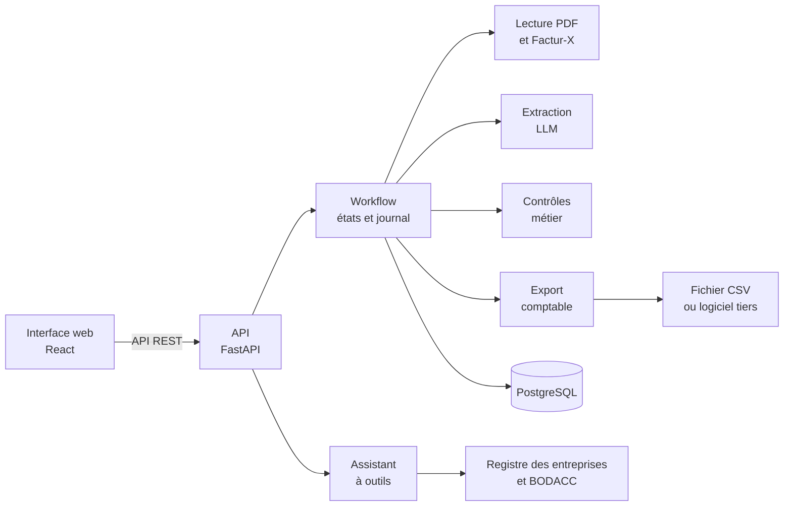
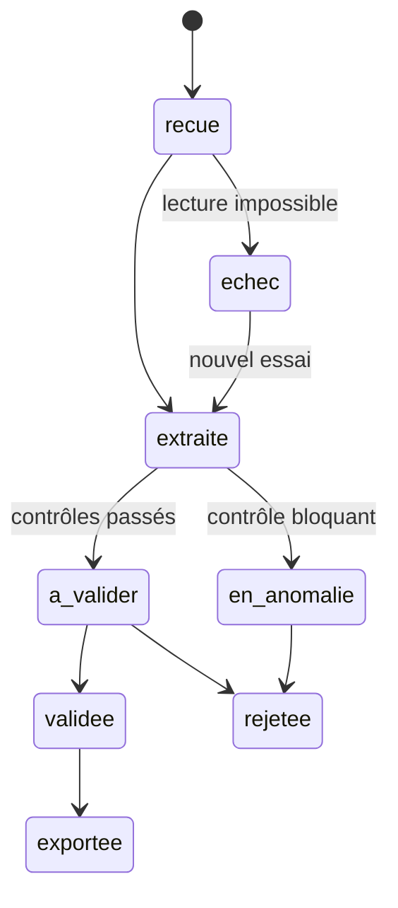

# DocuFlow AI

Traitement automatique des factures fournisseurs : lecture, contrôle, validation et envoi à la comptabilité.

Une entreprise reçoit des factures en PDF. Aujourd'hui, une personne les lit et recopie les montants dans son logiciel de comptabilité. DocuFlow fait la lecture et les vérifications ; la personne ne fait plus que décider.

> Projet de démonstration. Les factures du dossier `factures/` sont fictives. Une seule cite un fournisseur réel, l'entreprise MD Plomberie, avec l'accord de son dirigeant, pour montrer une vérification réussie auprès des registres de l'État : elle porte la mention « Spécimen » et ne correspond à aucune prestation réelle.

## Ce que fait le système

1. **Reçoit** une facture PDF, et reconnaît un fichier déjà reçu sans le retraiter.
2. **Lit** les données :
   - facture électronique **Factur-X** : lecture directe du XML joint, sans IA ;
   - PDF ordinaire : lecture du texte sur place, puis extraction des champs par un LLM.
3. **Contrôle** les données avec des règles écrites en code, sans IA : totaux, TVA, SIRET, numéro de TVA, dates, doublons.
4. **Fait décider une personne** : rien n'est validé automatiquement.
5. **Envoie** la facture validée à la comptabilité, sous forme d'écriture au journal des achats.
6. **Garde la trace** de chaque étape : qui, quoi, quand, avec quel résultat.

Un **assistant** répond aux questions sur les factures, vérifie un fournisseur auprès des registres de l'État et rédige les courriels aux fournisseurs. Il propose des décisions, il ne les prend jamais.

## Le principe

```text
le LLM lit et propose  ->  les règles vérifient  ->  une personne décide
```

L'IA n'est jamais seule juge. Exemple réel rencontré pendant le développement : un petit modèle a recopié un numéro de TVA en perdant deux chiffres, sans rien signaler. Le contrôle de la clé du numéro de TVA détecte ce genre d'erreur à coup sûr.

## Architecture



| Dossier | Contenu |
|---|---|
| `moteur/` | Le moteur en Python : lecture, extraction, contrôles, workflow, export, assistant, API |
| `interface/` | L'interface web : React, TypeScript, Vite |
| `tests/` | 154 tests automatisés |
| `factures/` | Factures fictives et réponses attendues |
| `outils/` | Générateur de factures et outils de mesure |

### Les états d'une facture



Toute autre transition est refusée par le code. Une facture en anomalie ne peut pas être validée ; une facture ne peut pas être exportée deux fois.

## Chiffres mesurés

Mesures faites le 14 novembre 2026 sur les factures du dossier `factures/`, avec `uv run python -m outils.mesurer`.

| Étape | Temps |
|---|---|
| Lecture du texte d'un PDF | 8 à 22 ms |
| Lecture d'une facture Factur-X | 2,6 ms |
| Extraction par le LLM (`gpt-5.4-mini`) | 1,1 à 3,2 s, le plus souvent 1,2 à 1,6 s |
| Contrôles métier | moins de 1 ms |
| Traitement complet d'une facture par l'API | 1,2 à 2,3 s |

| Exactitude de l'extraction | Résultat |
|---|---|
| `gpt-5.4-mini`, 7 factures, dont une sans TVA | 149 valeurs justes sur 149 |
| `gpt-5.4-mini`, 3 factures | 69 sur 69 |
| `gpt-4.1-mini`, 3 factures | 69 sur 69 |
| `gpt-5.4-nano`, 3 factures | 68 sur 69 |

Ces chiffres portent sur des factures propres et peu nombreuses. Ils ne disent rien du taux d'erreur sur de vraies factures de clients, qui reste à mesurer sur un échantillon représentatif.

Pour comparaison, la plateforme open source Unstract, essayée au début du projet, mettait 20 s par facture, dont 9 s d'attente dans ses files internes.

## Lancer le projet

Prérequis : Python 3.12 ou plus, [uv](https://docs.astral.sh/uv/), Node.js 22, Docker.

```bash
cp .env.example .env              # puis remplir le mot de passe de la base et la clé OpenAI
docker compose up -d base         # PostgreSQL sur le port 5434
uv sync                           # dépendances Python
uv run uvicorn moteur.api:creer_application --factory --port 8010
```

Dans un second terminal :

```bash
cd interface
npm install
npm run dev                       # interface sur http://127.0.0.1:5180
```

La documentation interactive de l'API est sur http://127.0.0.1:8010/docs.

Pour charger les factures d'exemple :

```bash
uv run python -m outils.traiter_dossier
```

## Tests

```bash
uv run pytest
```

Les tests du workflow et de l'API tournent sur une vraie base PostgreSQL (base séparée `factures_test`). Les appels au LLM et aux services de l'État sont remplacés par des doublures : les tests ne coûtent rien et ne dépendent pas d'Internet.

Points couverts, entre autres : chaque contrôle métier, chaque transition interdite, la panne du LLM, la panne des services de l'État, deux dépôts simultanés du même fichier, deux dépôts simultanés de la même facture, un XML Factur-X piégé, l'agent qui tente de proposer une décision sans avoir lu la facture.

## Cahier de recette

À dérouler dans l'interface, avec les factures du dossier `factures/`.

| # | Action | Résultat attendu |
|---|---|---|
| 1 | Déposer `facture-F26-1193.pdf` | État « À valider », aucune anomalie, données identiques au PDF |
| 2 | Déposer de nouveau le même fichier | « Déjà reçu, rien n’a été refait », aucune nouvelle facture |
| 3 | Déposer `facture-erreur-total.pdf` | « En anomalie » : « HT + TVA font 1500,00 €, le total TTC indique 1600,00 € » |
| 4 | Essayer de valider la facture du point 3 | Bouton « Valider » inactif |
| 5 | Déposer `facture-erreur-siret.pdf` | « En anomalie » : SIRET invalide, champ surligné |
| 6 | Déposer `facture-facturx-FX-2026-0057.pdf` | « Lue sans IA », parcours « Lecture Factur-X » |
| 6 bis | Déposer `facture-md-plomberie-2026-118.pdf` | « À valider », TVA à 0 %, net à payer 1 090,00 € : la mention « TVA non applicable, art. 293 B du CGI » est comprise |
| 7 | Valider la facture du point 1 sans avoir saisi son nom | Demande de saisir son nom |
| 8 | Valider la facture du point 1 avec son nom | Mention « Validée par … » au journal |
| 9 | Envoyer la facture du point 8 à la comptabilité | Écriture affichée : 398,40 € au compte 606000, 79,68 € au 445660, 478,08 € au 401000 |
| 10 | Télécharger le fichier comptable | CSV lisible dans Excel, débits égaux aux crédits |
| 11 | Rejeter la facture du point 3 avec un motif | « Rejetée par … », motif au journal |
| 12 | Demander à l'assistant « Quelles factures posent problème ? » | Il liste les factures en anomalie avec la raison exacte |
| 13 | Dire à l'assistant qu'une facture conforme est fausse | Il relit la facture et refuse de proposer un rejet |
| 14 | Demander à l'assistant de vérifier le fournisseur de la facture 2026-118 | Trouvé au registre des entreprises, actif, aucune procédure collective au BODACC |
| 15 | Lui demander de vérifier le fournisseur d'une facture fictive | « Aucune entreprise ne porte ce SIRET » |

## Guide d'exploitation

| Situation | Que faire |
|---|---|
| Vérifier que le service tourne | `GET /sante` répond `{"etat":"ok"}` si l'API et la base répondent |
| Le LLM est en panne ou hors quota | La facture passe « Lecture impossible ». Redéposer le même fichier relance la lecture |
| Le registre des entreprises ne répond pas | L'assistant indique « vérification impossible » ; rien n'est bloqué |
| Le logiciel de comptabilité refuse un envoi | La facture reste « Validée », l'échec est au journal. Relancer l'envoi |
| Retrouver ce qui est arrivé à une facture | Son journal, dans l'interface ou par `GET /factures/{id}` |

## Configuration

Toutes les valeurs se règlent dans `.env` (voir `.env.example`).

| Variable | Rôle |
|---|---|
| `DATABASE_URL`, `POSTGRES_PASSWORD` | Base PostgreSQL |
| `LLM_FOURNISSEUR` | `openai` ou `gemini` : le fournisseur d'IA est interchangeable |
| `OPENAI_API_KEY`, `GEMINI_API_KEY` | Clés d'accès aux fournisseurs d'IA |
| `LLM_MODELE`, `AGENT_MODELE` | Modèles pour l'extraction et pour l'assistant |
| `EXPORT_COMPTE_CHARGE` | Compte de charge par défaut (606000) |
| `EXPORT_WEBHOOK_URL` | Adresse du logiciel de comptabilité, pour l'envoi direct |

## Choix techniques

- **Python** pour le moteur : la vitesse dépend de l'architecture, pas du langage. L'appel au LLM représente presque tout le temps de traitement.
- **Pas de file d'attente pour une facture seule** : c'est ce qui coûtait 9 secondes à Unstract.
- **Montants en décimal**, jamais en nombre à virgule flottante.
- **Format de réponse imposé au LLM** : il ne peut renvoyer que les champs attendus, et toute réponse hors format est rejetée.
- **Enregistrement en base avant la réponse HTTP** : sinon l'interface peut relire une donnée pas encore enregistrée.
- **Verrous en base** contre les dépôts simultanés : sans eux, la même facture déposée deux fois en même temps passait deux fois en validation.

## Limites et feuille de route vers la production

Ce qui manque, par ordre de priorité :

1. **Données personnelles** : les factures sont envoyées à OpenAI, hors d'Europe. Pour un client français, passer à un fournisseur hébergé en Europe (Mistral par exemple) ou à un modèle hébergé chez le client, après analyse RGPD.
2. **Connexion et rôles** : aujourd'hui, n'importe qui peut appeler l'API et signer du nom de son choix.
3. **Traitement asynchrone** : file de tâches, nouveaux essais automatiques, supervision des traitements bloqués.
4. **Lecture des scans et des photos** (reconnaissance de caractères).
5. **Correction d'une valeur par une personne**, avec nouveau passage des contrôles.
6. **Factures à plusieurs taux de TVA**, et format Factur-X UBL en plus du CII.
7. **Comptes comptables par fournisseur**, paramétrés avec le comptable du client.
8. **Exploitation** : migrations de base, sauvegardes, journaux structurés, métriques.
9. **Plusieurs entreprises clientes** sur la même plateforme, avec isolation stricte de leurs données.
10. **Mesure de l'exactitude** sur un échantillon de vraies factures du client.
